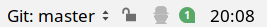
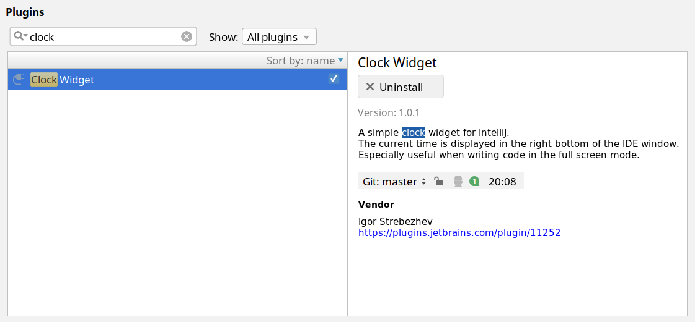

## Clock widget plugin for Intellij IDEA [](https://github.com/xamgore/intellij-clock/actions/workflows/build.yml)

Plugin displays the current time in the right bottom of the IDE window. That is especially useful when writing code in the full screen mode.


<br>

Click the clock to choose a 24-hour, 12-hour, locale-based, or custom format (set in Registry under `intellij-clock.format.pattern`).

Plugin is published on [plugins.jetbrains.com](https://plugins.jetbrains.com/plugin/11252-clock-widget) and can be easily installed via **Settings | Plugins** window.




## Clock format

The default format is **24 hours**.

Open **Registry…** through **Find Action** to edit the advanced options.

* `intellij-clock.format.pattern` sets the Java `DateTimeFormatter` pattern for **Custom**. For example, `EEE d MMM, HH:mm` includes the date. An empty or invalid pattern displays 24-hour time.
* `intellij-clock.format.locale` sets the formatting locale for all modes. Use a BCP 47 tag such as `ru-RU` or `zh-CN`. Leave it empty to use the runtime's formatting locale.

## Building

```bash
git clone https://github.com/xamgore/intellij-clock.git
cd intellij-clock
```

The plugin targets IntelliJ IDEA 2025.3.2 through 2026.3. Install JDK 21 and use the Gradle wrapper (`gradlew` or `gradlew.bat`).

* `./gradlew buildPlugin` creates the ZIP in `build/distributions`. Install it via **Settings | Plugins | Install Plugin from Disk**.
* `./gradlew runIde` opens a development IDE with the plugin installed.
* `./gradlew check verifyPluginStructure verifyPlugin` runs the project checks and verifies the plugin against the supported IDE branches.

## Developing

[Download IntelliJ IDEA](https://www.jetbrains.com/idea/download/) and use **File | Open** to open the repository directory as a Gradle project. JetBrains recommends **Plugin DevKit** for IDE inspections and plugin development tooling. The Gradle build runs independently.

## Deploy

Push a tag such as `v2.1.0` that matches the version in `build.gradle`. GitHub Actions builds and verifies the plugin, then automatically submits the ZIP to [JetBrains Marketplace](https://plugins.jetbrains.com/plugin/11252-clock-widget) for review.
